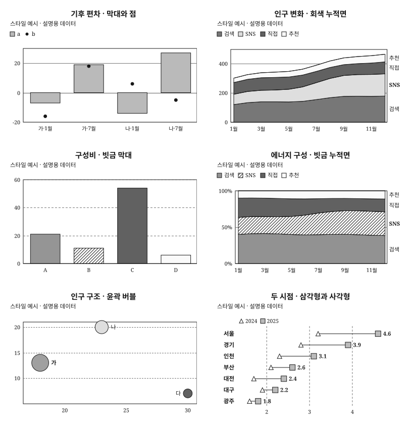

# 수능 인쇄 스타일

차트를 선택하고 **ZTD 차트 스튜디오 → 수능 인쇄 스타일**을 연다. 프리셋은 즉시 적용되며, CSS는 **CSS 적용**을 눌러 저장한다. `update-style`을 사용하는 차트 단위 변경으로 Undo가 가능하다. 이 모드에서 캔버스는 호버·애니메이션 대신 내보낼 SVG를 그대로 표시한다. **인쇄 스타일 초기화**는 프리셋과 CSS만 지우고 일반 보기로 돌아간다.



| references 스크린샷 시각 | 프리셋 ID · 권장 유형 | 반영하는 표현 |
| --- | --- | --- |
| 1.06.00 | `climate` · `bar` | 회색 막대, 먹색 점, 단색 외곽선. 보조 계열은 `encoding.line`에 연결해야 한다. |
| 1.06.19 | `population` · `area` | 명도 차가 있는 면과 직선 경계. 세 패널은 별개 차트를 나란히 배치한다. |
| 1.06.39 | `bars` · `bar` | 사각 막대, 두 번째 계열/항목에 사선 빗금, 수평 점선 눈금. |
| 1.06.43 | `energy` · `area` | 회색 면과 빗금 면. 백분율은 차트 옵션 `stack: "percent"`로 별도 지정한다. |
| 1.06.51 | `bubbles` · `bubble` | 원의 크기와 중심을 보존하면서 회색 채움, 얇은 먹선, 점선 눈금을 적용한다. |
| 1.07.07 | `periods` · `dumbbell` | 얇은 연결선, 시작 △와 끝 □. 차트 내 시점 범례도 같은 기호로 바뀐다. |

**범위:** 원본의 데이터나 단위를 추측하지 않는다. 이중 축, 연도 축의 세로 전환, 버블 크기 범례 상자, 지시선·출처 주석은 자동 생성하지 않는다. 6개 프리셋 모두 47종 전체에서 사용할 수 있다. 막대·누적면뿐 아니라 파이, 도넛, 와플, 트리맵 등 범주 면에서는 빗금을 사용하고, 여러 계열의 선에는 선종을 적용한다. 셀·지역의 명암이 수치를 나타내는 차트에서는 빗금으로 값을 덮지 않으며, 흐름도와 지도에서 양을 나타내는 선 폭도 바꾸지 않는다. 두 시점을 뜻하는 △·□는 덤벨 차트에서만 사용한다. 예를 들어 서로 다른 단위의 강수와 기온을 한 스케일로 직접 겹치지 말고, 이중 축이 필요하면 별도 차트로 나눈다.

캔버스에서는 텍스트와 도형을 SVG로 직접 표시한다. 도형 크기는 캔버스 좌표를 기준으로 하며 확대·축소는 Alid 카메라가 처리한다. 일반·인쇄 보기와 SVG의 기본 서체는 영문·숫자가 CMU Serif, 한글이 Pretendard다. 같은 라벨 안에서도 글자별로 적용된다. CMU Serif 보통·굵은 글꼴(WOFF2)은 확장 번들과 Alid가 내보낸 SVG에 포함되므로 설치나 CDN 연결이 필요 없다. 한글은 기존처럼 로컬 Pretendard를 사용한다.

## CSS 선언

선택자 없이 속성 선언만 입력한다. 선언 하나라도 잘못되면 적용하지 않는다. 프리셋 없이 CSS만 입력해도 인쇄 보기를 사용할 수 있다. 색상은 `#rrggbb`, `--exam-font: serif`는 기본 혼합 서체, `sans-serif`는 영문까지 Pretendard를 우선한다. 스타일은 문서에 CSS로 삽입하지 않고 검증된 값만 벡터 속성으로 변환한다.

```css
--exam-paper: #ffffff;
--exam-ink: #171717;
--exam-fill: #999999;
--exam-grid: #555555;
--exam-grid-dash: 4 3;
--exam-stroke: 1.2px;
--exam-font: serif;
```

`--exam-fill`은 기본 데이터 채움색이다. 다계열 그래프에서는 다른 명암과 빗금으로 계열을 구분한다. `--exam-grid-dash`는 `none` 또는 1~99 정수 두 개(선 길이와 공백), `--exam-stroke`는 0.5~3px(소수 첫째 자리), `--exam-font`는 `serif` 또는 `sans-serif`를 받는다. 임의 선택자, URL, `@import`, 외부 글꼴은 지원하지 않는다.
